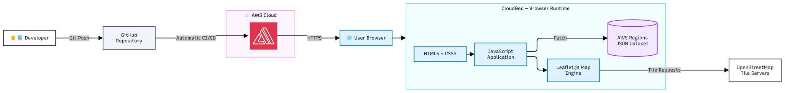

# ☁️ CloudGeo — AWS Regions Explorer

**Explore AWS global infrastructure through an interactive geographic experience.**

CloudGeo is an educational web application that helps developers, students, and cloud computing enthusiasts visualize and explore the geographic distribution of Amazon Web Services (AWS) Regions.

Built with HTML, CSS, JavaScript, and Leaflet.js, CloudGeo combines interactive mapping with a lightweight architecture deployed on **AWS Amplify Hosting**.

[🌐 Live Demo](https://main.d2cijkf9j4klap.amplifyapp.com) · [💻 GitHub Repository](https://github.com/AirtonNettu/cloudgeo) · [☁️ AWS Global Infrastructure](https://aws.amazon.com/about-aws/global-infrastructure/)

---

## 🎯 Project Overview

Understanding the global distribution of cloud infrastructure is an important part of learning cloud computing and designing applications.

AWS operates Regions across multiple geographic areas. However, exploring their distribution through lists and documentation alone may be less intuitive for beginners.

**CloudGeo provides a visual and interactive way to explore selected AWS Regions on a world map.**

The project focuses on simplicity, accessibility, geographic visualization, and practical AWS cloud deployment.

### Project Objectives

- Make AWS geographic infrastructure easier to understand.
- Provide an interactive educational experience.
- Demonstrate cloud-based hosting using AWS Amplify.
- Apply frontend development and geographic data visualization.
- Maintain a lightweight architecture without a dedicated backend.

---

## ✨ Features

| Feature | Description |
|---|---|
| 🗺️ Interactive Map | Explore AWS Regions on a world map |
| 📍 Geographic Markers | Identify approximate locations of selected AWS Regions |
| 🔎 Search | Search by region name, code, city, or country |
| 🌍 Continent Filtering | Filter displayed regions by continent |
| 📊 Dashboard | Display total regions, continents, and visible regions |
| ☁️ Region Details | View identifiers and geographic information |
| 📱 Responsive Layout | Adapt the interface to different screen sizes |
| 🚀 Continuous Deployment | Automatically deploy changes from GitHub using AWS Amplify |

### Supported Dataset

The current dataset includes six AWS Regions distributed across five continents.

The geographic coordinates are approximate and are intended exclusively for educational visualization.

**CloudGeo does not expose AWS data center locations or private infrastructure information.**

---

## 🏗️ System Architecture

CloudGeo follows a lightweight static web architecture.

The application is deployed through AWS Amplify Hosting, while the browser handles the interface, geographic data processing, and interactive map rendering.



### Architecture Overview

**1. Developer and GitHub**

The project source code is maintained in a GitHub repository.

Changes pushed to the `main` branch trigger the configured AWS Amplify deployment pipeline.

**2. AWS Amplify Hosting**

AWS Amplify provides managed hosting for the application's static assets, including HTML, CSS, JavaScript, and the geographic JSON dataset.

**3. Browser Runtime**

The browser executes the JavaScript application and loads the AWS Regions dataset.

Leaflet.js renders geographic markers, manages map interactions, and provides navigation controls.

**4. OpenStreetMap Integration**

The application requests geographic map tiles from OpenStreetMap tile servers.

OpenStreetMap provides the geographic background, while CloudGeo adds AWS Region information as an application-specific data layer.

### Data Flow

```text
Developer
    |
    | Git Push
    v
GitHub Repository
    |
    | Automatic Deployment
    v
AWS Amplify Hosting
    |
    | HTTPS
    v
End User Browser
    |
    +-- HTML / CSS / JavaScript
    |
    +-- Fetch AWS Regions JSON
    |
    +-- Leaflet.js Map Rendering
            |
            | Map Tile Requests
            v
      OpenStreetMap
```

### Architecture Decisions

| Decision | Rationale |
|---|---|
| Static Web Architecture | Reduces infrastructure complexity |
| No Dedicated Backend | The initial dataset does not require a server-side API |
| JSON Dataset | Keeps geographic data separate from application logic |
| Leaflet.js | Provides lightweight interactive mapping capabilities |
| AWS Amplify | Provides managed hosting and GitHub-based deployment |
| Client-Side Filtering | Enables responsive search without backend requests |

---

## 🛠️ Technology Stack

| Technology | Responsibility |
|---|---|
| HTML5 | Semantic application structure |
| CSS3 | Styling and responsive design |
| JavaScript | Application logic and interaction |
| Leaflet.js | Geographic visualization |
| OpenStreetMap | Map tiles and geographic background |
| JSON | Structured AWS Region dataset |
| AWS Amplify Hosting | Managed cloud hosting |
| GitHub | Version control and deployment integration |
| Git | Source code version control |

### Why These Technologies?

CloudGeo was intentionally designed without unnecessary infrastructure components.

The combination of JavaScript, Leaflet, and JSON provides sufficient functionality for the initial use case while keeping the project easy to maintain and deploy.

AWS Amplify handles the hosting infrastructure, allowing development effort to remain focused on the application experience.

---

## 📁 Project Structure

```text
cloudgeo/
├── dados/
│   └── regioes.json
│
├── docs/
│   └── architecture/
│       └── cloudgeo-architecture.svg
│
├── .gitignore
├── index.html
├── style.css
├── app.js
└── README.md
```

### Directory Responsibilities

**`index.html`**

Defines the interface structure, map container, dashboard, search field, geographic filters, and region information panel.

**`style.css`**

Defines the visual design, layout, dashboard cards, and responsive behavior.

**`app.js`**

Implements the application logic, including:

- Leaflet initialization
- JSON data loading
- Geographic marker rendering
- Search and filtering
- Dashboard updates
- Region information panels
- Map interactions

**`dados/regioes.json`**

Contains structured geographic information about the selected AWS Regions.

**`docs/architecture/`**

Stores the visual architecture documentation.

---

## 🌎 Geographic Dataset

CloudGeo currently includes the following AWS Regions:

| Region Code | AWS Region | Country |
|---|---|---|
| `sa-east-1` | South America (São Paulo) | Brazil |
| `us-east-1` | US East (N. Virginia) | United States |
| `us-west-2` | US West (Oregon) | United States |
| `eu-west-1` | Europe (Ireland) | Ireland |
| `ap-northeast-1` | Asia Pacific (Tokyo) | Japan |
| `af-south-1` | Africa (Cape Town) | South Africa |

### Dataset Structure

Each region follows a consistent JSON schema:

```json
{
  "codigo": "sa-east-1",
  "nome": "South America (São Paulo)",
  "cidade": "São Paulo",
  "pais": "Brasil",
  "continente": "América do Sul",
  "latitude": -23.5505,
  "longitude": -46.6333
}
```

The coordinates represent approximate geographic reference points rather than precise AWS facility locations.

For current AWS Region information, refer to the [official AWS Global Infrastructure documentation](https://aws.amazon.com/about-aws/global-infrastructure/regions_az/).

---

## 💻 Local Development

### Prerequisites

- Modern web browser
- Git
- Python 3 or another local HTTP server
- Internet connection for external map tiles and Leaflet assets

### 1. Clone the Repository

```bash
git clone https://github.com/AirtonNettu/cloudgeo.git
```

### 2. Enter the Project Directory

```bash
cd cloudgeo
```

### 3. Start a Local HTTP Server

```bash
python -m http.server 8000
```

### 4. Open the Application

Navigate to:

`http://localhost:8000`

### Local Development Notes

CloudGeo does not require a database, backend service, API key, or application build framework.

A local HTTP server is recommended because the application loads its JSON dataset using the browser Fetch API.

Opening the HTML file directly through the `file://` protocol may prevent JSON loading due to browser security restrictions.

---

## ☁️ AWS Cloud Deployment

CloudGeo uses **AWS Amplify Hosting** to publish its static application.

### Hosting Architecture

| Component | Configuration |
|---|---|
| Cloud Provider | Amazon Web Services |
| Hosting Service | AWS Amplify Hosting |
| AWS Region | US East (N. Virginia), `us-east-1` |
| Source Provider | GitHub |
| Repository | `AirtonNettu/cloudgeo` |
| Deployment Branch | `main` |
| Application Type | Static Website |
| Build Framework | None |
| Artifact Directory | `.` |
| HTTPS | Managed by Amplify |

### Deployment Pipeline

1. A developer commits application changes.
2. Changes are pushed to GitHub.
3. AWS Amplify detects the updated branch.
4. Amplify executes the configured build stage.
5. Static assets are published.
6. The application becomes accessible through its HTTPS endpoint.

### Live Application

**[Open CloudGeo on AWS Amplify](https://main.d2cijkf9j4klap.amplifyapp.com)**

AWS Amplify Hosting is a usage-based service. Actual charges depend on account eligibility, available credits, build usage, data storage, and transfer.

---

## 🔐 Security Considerations

CloudGeo implements a minimal architecture that avoids unnecessary exposure of credentials and backend resources.

### Security Characteristics

- No AWS access keys are required in the browser.
- No user authentication is required.
- No dedicated database is exposed.
- No application-side credential storage is implemented.
- Geographic data is publicly oriented.
- Dynamic interface text uses DOM text APIs instead of injecting untrusted HTML.
- Deployment access is managed through the configured GitHub and AWS integration.

### Important Limitations

CloudGeo is an educational application and should not be treated as an authoritative source for AWS infrastructure placement or service availability.

The geographic markers represent approximate regional locations.

---

## 🧪 Validation and Testing

The following functional checks are recommended before each release:

- Verify the application loads over HTTPS.
- Confirm the geographic JSON dataset loads successfully.
- Check that AWS Region markers appear.
- Validate search using AWS Region codes.
- Verify continent filtering.
- Test marker selection and region details.
- Verify dashboard counters.
- Test mobile and desktop layouts.
- Check browser console errors.
- Confirm the AWS Amplify deployment succeeds.

The initial MVP uses manual functional validation. Automated tests are planned as a future improvement.

---

## 📈 Project Roadmap

### Phase 1 — Initial MVP

- [x] Create a static frontend application.
- [x] Integrate Leaflet.js.
- [x] Create an AWS Regions JSON dataset.
- [x] Implement geographic markers.
- [x] Add region search.
- [x] Add continent filters.
- [x] Deploy through AWS Amplify.
- [x] Connect GitHub automated deployment.

### Phase 2 — User Experience

- [x] Implement dashboard components.
- [x] Implement region information panels.
- [ ] Complete cross-browser and mobile validation.
- [ ] Improve map navigation and zoom behavior.
- [ ] Add visual legends and enhanced interaction states.

### Phase 3 — Future Improvements

- [ ] Expand coverage to more AWS Regions.
- [ ] Add additional verified region metadata.
- [ ] Introduce Availability Zone information.
- [ ] Add comparison features.
- [ ] Implement automated frontend tests.
- [ ] Improve accessibility.
- [ ] Add automated dataset validation.

---

## 📚 References and Documentation

- [AWS Global Infrastructure](https://aws.amazon.com/about-aws/global-infrastructure/)
- [AWS Amplify Documentation](https://docs.aws.amazon.com/amplify/)
- [AWS Architecture Center](https://aws.amazon.com/architecture/)
- [AWS Architecture Icons](https://aws.amazon.com/architecture/icons/)
- [Leaflet.js Documentation](https://leafletjs.com/)
- [OpenStreetMap](https://www.openstreetmap.org/)
- [GitHub Documentation](https://docs.github.com/)

---

## 📄 License

No open-source license has been selected for this repository.

Although the source code is publicly accessible on GitHub, public visibility alone does not grant permission to redistribute, modify, or commercially reuse it.

---

## 👨‍💻 Author

**José Airton**

Software Engineering | Backend Development | AWS Cloud Computing

GitHub: [@AirtonNettu](https://github.com/AirtonNettu)

---

**☁️ CloudGeo — Making cloud infrastructure easier to explore.**