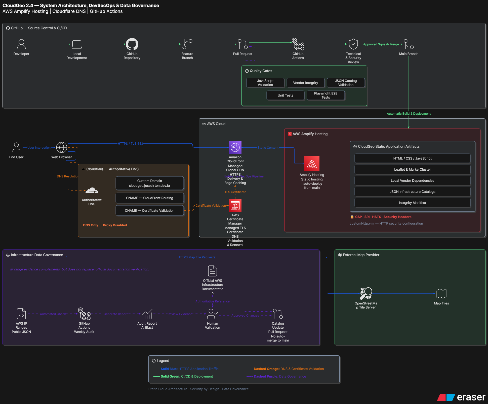

# ☁️ CloudGeo — AWS Global Infrastructure Explorer

[](https://cloudgeo.joseairton.dev.br)
[](https://github.com/AirtonNettu/cloudgeo/actions/workflows/quality.yml)
[](docs/SECURITY-AUDIT-INTEGRATED.md)
[](LICENSE)

**Aplicação web interativa para exploração, visualização cartográfica e análise arquitetural da infraestrutura global da Amazon Web Services (AWS).**

Desenvolvido com foco em excelência de engenharia de nuvem, segurança defensiva de ponta a ponta e governança factual contínua dos dados.

---

## 🔗 Live Application

Acesse a aplicação em produção:

### 🌐 [https://cloudgeo.joseairton.dev.br](https://cloudgeo.joseairton.dev.br)

- **Hospedagem**: AWS Amplify Hosting (us-east-1)
- **Borda / Distribuição**: Amazon CloudFront (CDN global gerenciada)
- **Certificado TLS**: AWS Certificate Manager (ACM)
- **Gerenciamento DNS**: Cloudflare (*DNS Only* mode)

---

## 🎯 Project Overview

Compreender como a infraestrutura física de nuvem está distribuída globalmente é um pré-requisito indispensável para arquitetos de soluções, engenheiros de dados e desenvolvedores projetarem sistemas altamente resilientes, tolerantes a falhas, com baixa latência e conformes a requisitos regulatórios e de soberania digital (como LGPD, GDPR e Schrems II).

O **CloudGeo** foi concebido como um projeto educacional de computação em nuvem que transforma tabelas estáticas de documentação em uma experiência geográfica dinâmica e rica em metadados arquiteturais.

A aplicação permite:
- Visualizar a distribuição geográfica de **Regiões AWS**, **AWS Local Zones** e cidades com **Points of Presence (PoPs) do CloudFront**.
- Entender a relação de ancoragem entre zonas de baixa latência e suas respectivas regiões-mãe (*Parent Regions*).
- Explorar as partições isoladas da AWS (`aws`, `aws-us-gov`, `aws-cn` e `aws-eusc`).
- Avaliar a presença de infraestrutura de nuvem por continente com filtros combinados em tempo real.

---

## 📊 Infrastructure Catalog

Todos os valores do catálogo são calculados e validados dinamicamente a partir dos conjuntos de dados em `dados/`:

| Categoria | Registros Catalogados | Detalhamento do Estado Operacional |
|---|:---:|---|
| **Regiões AWS** | **39** | **39 Operacionais (GA)** divididas em 4 partições independentes:<br>• **34 Comerciais Padrão (`aws`)**: Américas (8), Europa (8), Ásia/Oriente Médio (14), Oceania (3) e África (1).<br>• **2 AWS GovCloud (`aws-us-gov`)**: `us-gov-east-1` e `us-gov-west-1` (conformidade FedRAMP High, ITAR).<br>• **2 AWS China (`aws-cn`)**: `cn-north-1` (Pequim - Sinnet) e `cn-northwest-1` (Ningxia - NWCD).<br>• **1 AWS European Sovereign Cloud (`aws-eusc`)**: `eusc-de-east-1` (Brandemburgo, Alemanha - lançada em jan/2026). |
| **AWS Local Zones** | **49** | **49 Registros Conciliados com a Documentação Oficial**:<br>• **35 Operacionais (GA)**: Confirmadas na tabela *Available Local Zones* do guia da AWS, disponíveis para *opt-in* e provisionamento (ex.: Atlanta, Boston, Chicago, Dallas, Los Angeles, Buenos Aires, Santiago, Lima, Bogotá, Copenhague, Hamburgo, Atenas, Istambul, Hanói, etc.).<br>• **13 Anunciadas (Em Planejamento)**: Formalmente comunicadas no mapa global da AWS, porém ausentes da tabela de zonas disponíveis para criação de subnets (Rio de Janeiro, Toronto, Vancouver, Munique, Praga, Amsterdã, Bruxelas, Viena, Lisboa, Joanesburgo, Nairóbi, Chennai e Bengaluru).<br>• **1 Reclassificada / Descontinuada**: Detroit, atendida oficialmente pelo serviço **AWS Wavelength** (`us-east-1-wl1-dtw-wlz-1`) em parceria 5G com a Verizon. |
| **CloudFront Points of Presence** | **108** | **108 Cidades Sedes Catalogadas**:<br>• *Esclarecimento Métrico*: O catálogo registra as 108 metrópoles mundiais documentadas com presença de borda, e **não** a quantidade física de equipamentos. A AWS opera **mais de 750+ PoPs físicos e Edge Caches** consolidados mundialmente nessas localidades, atendendo o Amazon CloudFront e o Amazon Route 53. |
| **Total Consolidado** | **196** | **Distribuição em 6 Continentes Padronizados**:<br>• América do Norte: 59 pontos (9 Regiões, 20 Local Zones, 30 cidades CloudFront)<br>• Ásia: 54 pontos (16 Regiões, 9 Local Zones, 29 cidades CloudFront)<br>• Europa: 53 pontos (9 Regiões, 12 Local Zones, 32 cidades CloudFront)<br>• América do Sul: 14 pontos (1 Região, 5 Local Zones, 8 cidades CloudFront)<br>• Oceania: 9 pontos (3 Regiões, 1 Local Zone, 5 cidades CloudFront)<br>• África: 7 pontos (1 Região, 2 Local Zones, 4 cidades CloudFront) |

> [!NOTE]
> Para detalhes completos sobre metodologia, escopo das partições e documentação de referência, consulte [dados/FONTES.md](dados/FONTES.md) e o [Relatório de Auditoria Factual](dados/RELATORIO_AUDITORIA_DADOS.md).

---

## 🏗️ System Architecture

A topologia do CloudGeo 2.4 combina uma esteira automatizada de qualidade e segurança com uma arquitetura estática de borda de alto desempenho:



### Fluxos da Arquitetura:

1. **Resolução de DNS e Roteamento Seguro**:
   - O domínio `cloudgeo.joseairton.dev.br` é gerenciado na **Cloudflare** utilizando um registro CNAME configurado em modo *DNS Only* (sem proxy intermediário), preservando a comunicação direta de ponta a ponta com a infraestrutura da AWS.
2. **Distribuição Global e Borda (AWS Amplify Hosting & CloudFront)**:
   - A aplicação estática é hospedada no **AWS Amplify Hosting** na região raiz (`us-east-1`) e distribuída globalmente via **Amazon CloudFront**.
   - O tráfego HTTPS é protegido por certificado TLS gerenciado emitido pelo **AWS Certificate Manager (ACM)**.
   - Cabeçalhos defensivos de segurança são injetados nas respostas HTTP em nível de borda pelo CloudFront a partir do arquivo [customHttp.yml](customHttp.yml).
3. **Pipeline de Qualidade e DevSecOps (GitHub Actions)**:
   - Cada *push* ou *pull request* aciona o workflow [quality.yml](.github/workflows/quality.yml), executando lint sintático, validação criptográfica de dependências locais, testes de esquema JSON, testes unitários de filtros e testes E2E Playwright.
4. **Governança Periódica de Dados**:
   - O workflow [data-audit.yml](.github/workflows/data-audit.yml) executa auditorias semanais ou manuais comparando os catálogos com o feed público de IP Ranges da AWS e a documentação oficial, gerando relatórios versionados como artefatos de build.
5. **Aplicação Cliente & Vendoring Local**:
   - Aplicação web em HTML5, CSS3 e JavaScript Vanilla sem dependências externas em runtime.
   - Bibliotecas Leaflet e Leaflet MarkerCluster armazenadas localmente em `vendor/` e protegidas por hashes SRI.
   - Tiles cartográficos consumidos diretamente do OpenStreetMap via HTTPS.

---

## 🛠️ Technology Stack

As tecnologias foram selecionadas para garantir máxima longevidade, zero custo desnecessário de infraestrutura e imunidade operacional:

### Dependências de Produção (Runtime)
- **Frontend Core**: HTML5 Semântico, CSS3 Moderno (Dark Theme e responsividade móvel), Vanilla JavaScript (ES6+ modular UMD).
- **Cartografia e Visualização**:
  - [Leaflet 1.9.4](https://leafletjs.com/) (Licença BSD-2-Clause) — biblioteca de mapas interativos.
  - [Leaflet.markercluster 1.5.3](https://github.com/Leaflet/Leaflet.markercluster) (Licença MIT) — algoritmo de agrupamento e *spiderfy* de marcadores.
- **Camada Cartográfica**: [OpenStreetMap](https://www.openstreetmap.org/) (ODbL).
- **Armazenamento de Dados**: Arquivos JSON estáticos versionados com validação de esquema.

### Infraestrutura de Nuvem e Borda
- **Hospedagem**: [AWS Amplify Hosting](https://aws.amazon.com/amplify/hosting/).
- **Content Delivery Network (CDN)**: [Amazon CloudFront](https://aws.amazon.com/cloudfront/).
- **Gerenciamento de Certificados**: [AWS Certificate Manager (ACM)](https://aws.amazon.com/certificate-manager/).
- **DNS**: [Cloudflare](https://www.cloudflare.com/) (modo *DNS Only*).

### Ferramentas de Desenvolvimento e Qualidade (DevDependencies)
- **Ambiente de Execução**: Node.js (v18+).
- **Test Runner Unitário**: `node:test` e `node:assert` (nativo do Node.js, sem frameworks adicionais).
- **Testes Ponta a Ponta (E2E)**: [@playwright/test](https://playwright.dev/) (v1.58.0).
- **Automação CI/CD**: GitHub Actions com actions fixadas por commit SHA.

---

## 🛡️ Security Architecture

O CloudGeo adota um rigoroso modelo de **Defesa em Profundidade (*Defense-in-Depth*)**:

```text
Navegador do Usuário ──► [Cabeçalhos HTTP Defensivos (CloudFront)]
                             ├── HSTS (max-age=31536000; includeSubDomains)
                             ├── Content-Security-Policy (script-src 'self')
                             ├── X-Frame-Options: DENY
                             ├── X-Content-Type-Options: nosniff
                             ├── Referrer-Policy: strict-origin-when-cross-origin
                             └── Permissions-Policy: camera=(), microphone=(), ...
                             
                         [Validação de Integridade no Navegador]
                             ├── Subresource Integrity (SRI SHA-384 no HTML)
                             └── Vendoring Local 100% isolado (vendor/)
                             
                         [Sanitização no Cliente]
                             ├── Manipulação segura do DOM (textContent, createElement)
                             └── Validação regex contra pseudoprotocolos (/^https?:\/\//i)
```

### Controles de Segurança Implementados:
1. **Supply Chain Security & Vendoring Local**:
   - Zero dependência de CDNs públicas em runtime (como `unpkg.com`). Todos os arquivos JavaScript, CSS, imagens e licenças estão armazenados localmente em `vendor/`.
   - O arquivo [vendor/integrity-manifest.json](vendor/integrity-manifest.json) cataloga os hashes SHA-384 e SHA-256 de todos os 12 arquivos do vendor.
   - O arquivo [.gitattributes](.gitattributes) fixa `vendor/** -text`, garantindo preservação binária exata entre Windows e Linux.
2. **Content Security Policy (CSP)**:
   - `default-src 'self'`: Restrição padrão de recursos à própria origem.
   - `script-src 'self'`: Impede a injeção e execução de scripts de terceiros (mitigação primária contra XSS).
   - `style-src 'self' 'unsafe-inline'`: Permite estilização local e posicionamento de elementos dinâmicos do Leaflet.
   - `img-src 'self' data: https://*.tile.openstreetmap.org`: Permite imagens locais e tiles do OpenStreetMap.
   - `object-src 'none'`: Desabilita plugins legados.
   - `frame-ancestors 'none'`: Impede ataques de *Clickjacking* em navegadores modernos.
3. **Cabeçalhos de Segurança HTTP na Borda**:
   - Configurados em [customHttp.yml](customHttp.yml) e aplicados pela CDN CloudFront: HSTS (1 ano), `X-Frame-Options: DENY`, `X-Content-Type-Options: nosniff`, `Referrer-Policy: strict-origin-when-cross-origin` e `Permissions-Policy`.
4. **Isolamento de Artefatos no Host ([amplify.yml](amplify.yml))**:
   - Estratégia de publicação por **allowlist estrita**: apenas `index.html`, `style.css`, `app.js`, `data-filters.js`, `customHttp.yml`, `dados/*.json`, `vendor/**/*` e o SVG arquitetural são publicados.
   - Diretórios `tests/`, `scripts/`, `.github/`, `node_modules/` e manifestos de pacotes jamais são expostos no CDN de produção.
5. **Higiene do DOM e Sanitização de URLs**:
   - Prevenção contra injeção de scripts utilizando `textContent` e `createElement`. Links externos são auditados por expressão regular antes de serem injetados.

> [!NOTE]
> Para a matriz de conformidade detalhada com base no NIST SP 800-53 e OWASP Top 10, consulte [docs/SECURITY-AUDIT-INTEGRATED.md](docs/SECURITY-AUDIT-INTEGRATED.md).

---

## 🧪 Quality Engineering & DevSecOps

A garantia de qualidade do CloudGeo é automatizada e obrigatória antes de qualquer integração com a branch de produção:

| Etapa de Qualidade | Ferramenta / Mecanismo | Escopo / Cobertura | Status |
|---|---|---|:---:|
| **Validação Sintática** | `node --check` | `app.js` e `data-filters.js` | ✅ Aprovado |
| **Integridade de Dependências** | `scripts/verify-vendor-integrity.js` | 12 arquivos em `vendor/` auditados contra SHA-384 e SHA-256 | ✅ Aprovado |
| **Validação dos Catálogos** | `scripts/validate-catalogs.js` | 196 registros auditados (campos obrigatórios, limites geográficos, unicidade e prevenção de Prototype Pollution) | ✅ Aprovado |
| **Testes Unitários de Produção** | `tests/unit/data-filters.test.js` | **10 testes unitários** executados no test runner nativo do Node.js sobre o módulo de produção `data-filters.js` | ✅ 10/10 Aprovados |
| **Testes Ponta a Ponta (E2E)** | `tests/e2e/cloudgeo.spec.js` | **16 execuções de testes** com Playwright em Chromium Desktop ('Desktop Chrome') e Chromium Mobile ('Pixel 5') com mock offline de tiles | ✅ 16/16 Aprovados |
| **Sincronização Determinística** | Evento `moveend` do Leaflet | Aguarda estabilização do mapa e fim de zoom sem atrasos arbitrários (`waitForTimeout`) | ✅ Aprovado |
| **Esteira de CI/CD** | `.github/workflows/quality.yml` | Executado em todo Push e Pull Request no GitHub Actions | ✅ 100% Verde |

*Nota de Rigor Técnico*: Os testes de ponta a ponta utilizam exclusivamente o motor **Chromium** (nas resoluções desktop 1280x720 e mobile emulado Pixel 5 393x851). O CloudGeo **não** declara cobertura automatizada de Firefox, WebKit ou Safari sem evidências de execução.

---

## 📋 Data Governance

A governança dos catálogos de dados no CloudGeo segue critérios factuais rastreáveis:

1. **Metadados de Rastreabilidade**:
   - Cada registro nos catálogos JSON possui atributos de controle: `versaoEsquema`, `estadoOperacional`, `fonteOficial`, `dataUltimaVerificacao` e `categoria`.
2. **Auditoria Automatizada Periódica**:
   - O script [scripts/audit-aws-data.js](scripts/audit-aws-data.js) e o workflow [data-audit.yml](.github/workflows/data-audit.yml) executam semanalmente uma conferência contra o endpoint oficial `ip-ranges.amazonaws.com`.
   - O relatório gerado é publicado como artefato de build no GitHub Actions, garantindo visibilidade sem introduzir commits automatizados não revisados na branch `main`.
3. **Metodologia de Evidência e Papel do AWS IP Ranges**:
   - O AWS IP Ranges é utilizado como **evidência técnica complementar** de conectividade e roteamento ativo (`network_border_group`).
   - A ausência de prefixos IP no endpoint público **não é considerada prova de indisponibilidade**, pois algumas zonas locais utilizam roteamento privado através de sua região-mãe.
   - A classificação primária de disponibilidade baseia-se na **documentação técnica oficial da AWS** (*Available Local Zones User Guide* e anúncios institucionais).
4. **Atualizações Controladas**:
   - Modificações em catálogos exigem abertura de Pull Request, aprovação dos *Quality Gates* automatizados e revisão humana.

---

## 💻 Local Development

### Pré-requisitos
- **Node.js**: v18.0.0 ou superior.
- **Git**: v2.30 ou superior.
- **Navegador**: Qualquer navegador moderno compatível com padrões web (Google Chrome, Microsoft Edge, Mozilla Firefox, Apple Safari).

### Instalação e Execução

1. **Clonar o Repositório**:
   ```bash
   git clone https://github.com/AirtonNettu/cloudgeo.git
   cd cloudgeo
   ```

2. **Instalação Reproduzível das Dependências de Desenvolvimento**:
   ```bash
   npm ci
   ```

3. **Iniciar o Servidor Local Seguro**:
   ```bash
   npm start
   ```
   Acesse no navegador: `http://localhost:8080` (servidor isolado em `127.0.0.1` com verificação de caminhos canônicos).

4. **Executar a Suíte Completa de Testes**:
   ```bash
   npm test
   ```

### Comandos de Desenvolvimento Disponíveis

| Comando | Descrição |
|---|---|
| `npm test` | Executa a esteira completa: lint, integridade do vendor, validação de catálogos, testes unitários e testes E2E Playwright |
| `npm run lint:js` | Validação sintática dos scripts de produção (`app.js` e `data-filters.js`) |
| `npm run verify:vendor` | Audita os hashes SHA-384 e SHA-256 de todas as bibliotecas locais em `vendor/` |
| `npm run validate:catalogs` | Executa a validação de esquema, tipos e integridade geográfica dos 196 registros |
| `npm run test:unit` | Executa os 10 testes unitários no test runner nativo do Node.js |
| `npm run test:e2e` | Executa os 16 testes ponta a ponta com Playwright em Chromium |
| `npm run audit:data` | Executa a auditoria factual cruzando os catálogos com o AWS IP Ranges |
| `npm start` | Inicia o servidor estático local defensivo em `http://127.0.0.1:8080` |

---

## 💡 Architectural Decisions

As seguintes decisões de arquitetura orientam o design do CloudGeo:

1. **Arquitetura Estática (*Jamstack Pure Static*)**:
   - *Decisão*: Servir exclusivamente arquivos estáticos (HTML, CSS, JS, JSON e assets).
   - *Justificativa*: Elimina superfícies de ataque em backend (SQL injection, SSRF, RCE), garante disponibilidade de 99,99% através da CDN CloudFront e reduz o custo operacional de hospedagem a praticamente zero dentro do *free tier* do AWS Amplify.
2. **Ausência de Banco de Dados**:
   - *Decisão*: Utilizar arquivos JSON versionados no Git em vez de um banco relacional ou NoSQL.
   - *Justificativa*: O catálogo de infraestrutura da AWS é de leitura intensiva e baixa frequência de alteração. Armazenar os dados como arquivos estáticos permite cache imutável no navegador, rastreabilidade total via Git e tempos de resposta inferiores a 50 ms.
3. **Vendoring Local e Eliminação de CDNs de Terceiros**:
   - *Decisão*: Armazenar Leaflet e MarkerCluster diretamente no repositório.
   - *Justificativa*: Protege os usuários contra ataques de supply chain (*poisoning* em CDNs como unpkg), elimina pontos únicos de falha e permite endurecer a política de CSP com `script-src 'self'`.
4. **Módulo Isomórfico UMD (`data-filters.js`)**:
   - *Decisão*: Desacoplar a lógica de cálculo de dados e métricas da manipulação do mapa.
   - *Justificativa*: Permite que os mesmos algoritmos de filtragem executados no navegador sejam testados de forma pura e determinística em ambiente Node.js pelos testes unitários, sem necessidade de emular o DOM.
5. **DNS Only na Cloudflare**:
   - *Decisão*: Utilizar registros CNAME em modo cinza (*DNS Only*).
   - *Justificativa*: Evita duplo proxy reverso com o CloudFront do Amplify, simplifica a resolução TLS e garante que os cabeçalhos configurados no AWS Amplify sejam aplicados exatamente como pretendido.

---

## 📈 Project Evolution

A trajetória de engenharia do CloudGeo reflete um processo contínuo de amadurecimento técnico:

- **v1.0 — Initial Architecture (15/11/2026)**:
  - Criação da aplicação web com mapa Leaflet básico e catálogo inicial de regiões comerciais da AWS.
- **v2.0 — Global Infrastructure Explorer (19/11/2026)**:
  - Expansão para 39 Regiões nas 4 partições (`aws`, `aws-us-gov`, `aws-cn`, `aws-eusc`), incluindo a European Sovereign Cloud.
  - Inclusão de 46 Local Zones e 108 cidades com CloudFront PoPs.
  - Implementação de MarkerCluster, filtros por chips e dashboard em tempo real.
- **v2.1 — Security Hardening (21/11/2026)**:
  - Configuração de cabeçalhos HTTP defensivos no AWS Amplify via `customHttp.yml` (HSTS, CSP, X-Frame-Options, X-Content-Type-Options).
  - Implementação de Subresource Integrity (SRI).
- **v2.2 — Quality & CI/CD (21/11/2026)**:
  - Criação de suíte de testes unitários (`node:test`) e testes E2E (`playwright`).
  - Pipeline automatizado de GitHub Actions com cancelamento de execuções redundantes.
- **v2.3 — Supply Chain Security (21/11/2026)**:
  - Vendoring local completo de dependências em `vendor/`.
  - Criação do manifesto criptográfico de integridade e endurecimento da CSP para `script-src 'self'`.
- **v2.4 — Data Automation, Accuracy & Release Preparation (22/11/2026)**:
  - Reconciliação factual das 49 Local Zones (35 GA, 13 anunciadas, 1 reclassificada Wavelength em Detroit).
  - Automação de auditoria periódica com geração de artefatos de governança.
  - Módulo isomórfico `data-filters.js` e sincronização determinística no Playwright.
  - Disponibilização em produção no domínio `https://cloudgeo.joseairton.dev.br` e validação formal de cabeçalhos de borda.

---

## ⚖️ Disclaimer & Attributions

- **Projeto Educacional Independente**: O **CloudGeo** é um projeto de código aberto estritamente educacional, desenvolvido para fins de estudo e visualização arquitetural. Não é um serviço oficial da Amazon Web Services (AWS) nem possui qualquer afiliação comercial, endosso ou patrocínio da Amazon.com, Inc.
- **Marcas Registradas**: Amazon Web Services, AWS, o logotipo da AWS, Amazon CloudFront, AWS Local Zones e Route 53 são marcas comerciais registradas da Amazon.com, Inc. ou de suas afiliadas.
- **Dados Cartográficos**: Os mapas de fundo são fornecidos pelo [OpenStreetMap](https://www.openstreetmap.org/copyright), sob licença [Open Data Commons Open Database License (ODbL)](https://opendatacommons.org/licenses/odbl/).
- **Precisão e Limitações dos Dados**: As coordenadas geográficas correspondem aos centroides metropolitanos aproximados das cidades documentadas publicamente pela AWS. O CloudGeo **não armazena nem divulga localizações físicas exatas de data centers, galpões de infraestrutura ou cabeamentos proprietários**, em conformidade com as boas práticas de segurança física da computação em nuvem.

---

## 👨‍💻 Autor

**José Airton**  
Senior Cloud Engineer | Solutions Architect | DevSecOps  
- GitHub: [@AirtonNettu](https://github.com/AirtonNettu)
- Portfólio / Domínio: [https://cloudgeo.joseairton.dev.br](https://cloudgeo.joseairton.dev.br)

---

<p align="center">
  <b>CloudGeo 2.4 — Explorando a infraestrutura global da AWS com arquitetura, qualidade e segurança.</b>
</p>
