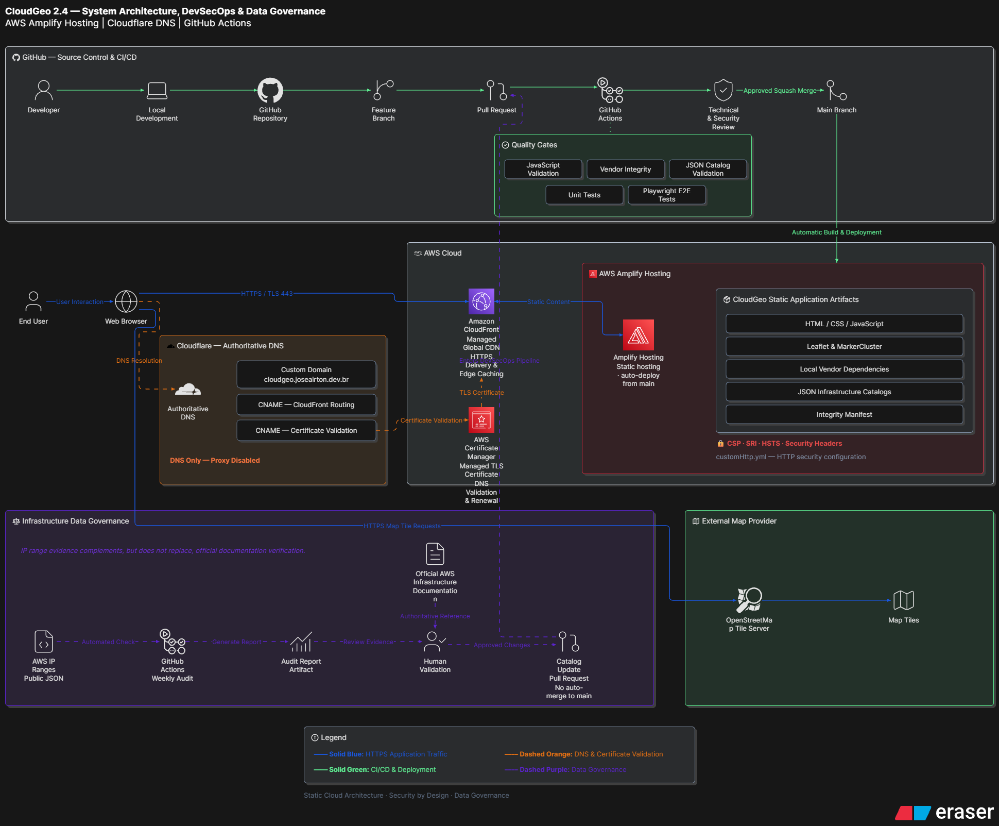

# 🏗️ CloudGeo Architecture Diagrams

Este diretório contém os diagramas de arquitetura oficiais que documentam a topologia de infraestrutura, os fluxos de distribuição, segurança e governança do **CloudGeo**.

---

## 1. Arquitetura Oficial da Versão 2.4 (Atual)

*Arquivo*: [`docs/architecture/cloudgeo-2.4-architecture.png`](cloudgeo-2.4-architecture.png)  
*Ferramenta de Modelagem*: Eraser  
*Versão de Referência*: CloudGeo 2.4.0  

### Componentes Representados:
1. **Cloudflare DNS**: Gerenciamento autoritativo de DNS em modo *DNS Only* (registro CNAME apontando para o endpoint do AWS Amplify Hosting).
2. **AWS Amplify Hosting & Amazon CloudFront**:
   - Hospedagem estática gerenciada com distribuição global via CloudFront.
   - Certificado TLS provisionado e renovado automaticamente via AWS Certificate Manager (ACM).
   - Injeção de cabeçalhos defensivos de borda (`customHttp.yml`): HSTS, CSP, X-Frame-Options, X-Content-Type-Options, Referrer-Policy e Permissions-Policy.
3. **Aplicação Cliente & Vendoring Local**:
   - HTML5 semântico, CSS3 e JavaScript Vanilla (ES6+).
   - Bibliotecas Leaflet 1.9.4 e Leaflet.markercluster 1.5.3 100% armazenadas localmente em `vendor/` com verificação de integridade criptográfica (Subresource Integrity - SRI SHA-384).
   - Datasets JSON em `dados/` com metadados de governança.
4. **Camada Cartográfica Externa**:
   - Tiles cartográficos servidos via HTTPS pelo OpenStreetMap sob licença Open Database License (ODbL).
5. **Quality Gates & DevSecOps (GitHub Actions)**:
   - Pipeline de CI (`quality.yml`): lint sintático, validação criptográfica de integridade de dependências (`scripts/verify-vendor-integrity.js`), validação estrutural de catálogos (`scripts/validate-catalogs.js`), 10 testes unitários em Node.js nativo (`tests/unit/data-filters.test.js`) e 16 testes ponta a ponta com Playwright em Chromium Desktop e Mobile (`tests/e2e/cloudgeo.spec.js`).
6. **Governança de Dados Automatizada**:
   - Workflow periódico (`data-audit.yml`): verificação semanal e manual cruzando os catálogos com o endpoint público `ip-ranges.amazonaws.com` e a documentação oficial da AWS, publicando relatórios de auditoria como artefatos sem commits automáticos na `main`.

---

## 2. Registro Histórico de Arquitetura

- **Versão Baseline (v2.1 / SVG)**: [`docs/architecture/cloudgeo-architecture.svg`](cloudgeo-architecture.svg)
  - Diagrama vetorial original preservado como registro histórico da evolução do projeto.
